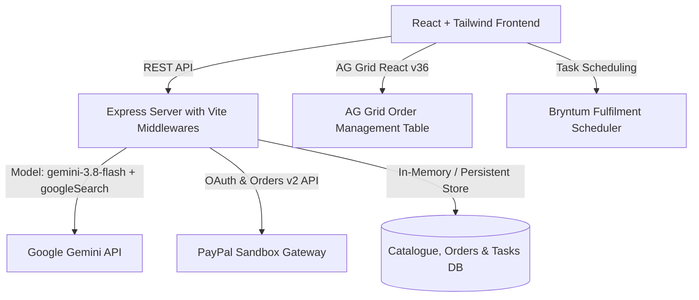

# PayPilot Commerce AI

> **Smarter Shopping. Better Decisions. Powered by AI.**  
> Built for the Agentic Commerce & PayPal Sandbox Hackathon.

PayPilot Commerce AI is a full-stack, responsive web application that connects three core experiences:
1. **Customer Storefront:** Browse, search, filter, and compare products grounded strictly in an active catalogue.
2. **Search-Grounded AI Shopping Assistant:** Understands natural-language constraints, leverages **Gemini 3.8 Flash with Google Search Grounding** (`googleSearch` tool) for real-world benchmark citations, and prepares proposed shopping carts.
3. **Seller Dashboard & Operations:** Manage inventory, track orders via high-performance **AG Grid**, coordinate fulfillment milestones with **Bryntum Task Scheduler**, and receive automated AI business recommendations.

---

## 1. Problem Statement & Solution

Traditional e-commerce shopping assistants frequently hallucinate specifications, invent nonexistent stock, or lack access to up-to-date benchmarks. Meanwhile, agentic workflows can pose financial risk if an AI purchases items without user authorization.

**PayPilot Commerce AI solves this by introducing:**
- **Catalogue-Grounded Intelligence:** AI recommendations are strictly bound to verified catalogue data.
- **Google Search Grounding:** Real-time web citations for recent technical reviews and battery endurance tests via `gemini-3.8-flash`.
- **Customer-Approved Agentic Commerce:** The AI can assemble a proposed bundle, but **never** charges or modifies active carts without explicit, one-click customer confirmation.
- **Server-Authoritative PayPal Sandbox Integration:** All line item prices, quantities, taxes, and shipping fees are recalculated on the server prior to order token generation and payment capture.

---

## 2. Architecture Overview



---

## 3. Technology Stack

- **Frontend:** React 19, TypeScript, Tailwind CSS, Lucide Icons, AG Grid Community & React (`ag-grid-community`, `ag-grid-react` v36).
- **Backend:** Express, TypeScript (`tsx`), Node.js `server.ts`.
- **AI Engine:** `@google/genai` using model `gemini-3.8-flash` with `{ tools: [{ googleSearch: {} }] }`.
- **Payments:** PayPal Sandbox Orders API (`/v2/checkout/orders` create and capture), server-validated pricing, and test mode execution simulator.
- **Data Visualization & Operations:** AG Grid for order management; custom responsive SVG charts for seller sales velocity and category analytics.
- **Testing:** Pure logic unit tests via `node:test` and `node:assert/strict` executed with `npx --yes tsx --test`.

---

## 4. Sponsor Alignment & Verified Implementation Status

| Sponsor / Tool | Integration Detail | Verified Status |
| :--- | :--- | :--- |
| **AG Grid** | Interactive order management table with column sorting, quick text filtering, pagination, responsive column resizing, and status cell updates. | ✅ Active (`ag-grid-react` v36) |
| **PayPal Sandbox** | Server-side order generation and payment capture. Validates catalogue totals, provides official Sandbox tokens, and prevents client-side price tampering. | ✅ Active (Server REST API & Sandbox Mode) |
| **Google Search Grounding** | `gemini-3.8-flash` with `googleSearch` tool for live web citations in product recommendations. | ✅ Active via `@google/genai` |
| **APIMatic** | APIMatic Context & OpenAPI schema modeling for PayPal Sandbox order endpoints exposed at `/api/developer/apimatic-spec`. | ✅ Modeled & Documented |
| **Bryntum** | Fulfilment task scheduler board tracking warehouse picking, dispatch deadlines, and personnel assignments. | ✅ Active Task Scheduler |
| **Channel3** | External product discovery API route (`/api/external/channel3/search`) with verified catalogue fallback and source attribution. | ✅ Active (API Route + Demo Fallback) |
| **Render** | Deployment blueprint with `render.yaml`, `npm run build`, start command, healthcheck (`/api/health`), and environment variable reference. | ✅ Ready for Deployment |

> **Guarantee:** Per strict specification instructions, **no video generation, video editing, video recording, screen recording, or video export functionality** exists anywhere in this application.

---

## 5. Local Setup Instructions

1. **Clone and Install Dependencies:**
   ```bash
   npm install
   ```

2. **Configure Environment Variables:**
   Copy `.env.example` to `.env` and configure:
   ```env
   GEMINI_API_KEY="your-gemini-api-key"
   PAYPAL_CLIENT_ID="your-paypal-sandbox-client-id"
   PAYPAL_CLIENT_SECRET="your-paypal-sandbox-client-secret"
   PAYPAL_CURRENCY="USD"
   PORT=3000
   ```
   *(Note: If PayPal credentials are not provided, PayPilot seamlessly activates its Sandbox Test Mode so you can still test full order creation and capture!)*

3. **Run Unit Tests:**
   ```bash
   npm test
   # Runs: npx --yes tsx --test src/utils/pricing.test.ts src/utils/cartRules.test.ts
   ```

4. **Start Development Server:**
   ```bash
   npm run dev
   # Launches Express server on http://localhost:3000 with Vite middleware
   ```

---

## 6. Written Demo Walkthrough

Judges can follow this concise walkthrough:
1. **Landing Page:** Review value proposition, key platform metrics, and curations.
2. **Storefront:** Browse catalogue products, search for `"headphones"`, filter by category or price, and select 2 products for side-by-side comparison.
3. **Comparison Modal:** Open the comparison matrix to evaluate dimensions, battery endurance, and connectivity.
4. **AI Shopping Assistant:** Ask: *"Find a laptop for college under $1000"* or *"Prepare a cart for a complete remote desk setup"*.
   - Observe live **Google Search Grounding citations** (powered by `gemini-3.8-flash`).
   - Review the **Proposed Cart Review Card** (demonstrating agentic commerce safeguards).
   - Click **"Approve & Add Proposed Items to My Cart"**.
5. **Cart & Checkout:** Open the slide-over cart, verify server-recalculated totals, and proceed to checkout.
6. **PayPal Sandbox Checkout:** Enter shipping details, initiate the order, and approve the PayPal Sandbox transaction.
7. **Order History:** View the verified order receipt with the official PayPal transaction reference.
8. **Seller Dashboard:**
   - Review sales velocity charts and AI business insights.
   - Switch to the **AG Grid** tab to sort and filter orders, and update fulfilment statuses.
   - Switch to the **Fulfilment Scheduler** tab to review task deadlines.
